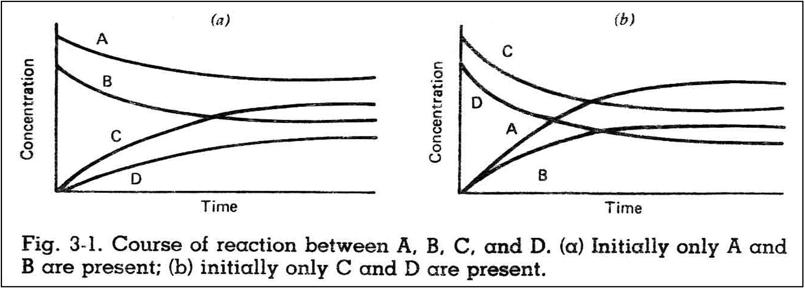

**Balanced chemical reactions are the math of chemistry**

- They show the relationship between the reactants and the products

**How will chemical reactions proceed?**

- Thermodynamics allows us to calculate the feasibility of reactions and to understand when/how equilibrium is established

**Equilibrium**

- Allows us to understand chemical processes such as ionic speciation, oxidation state distributions, gas solubility, the carbonate system

## Balancing equations, oxidation state, redox

<embed class="pdf-embed" src="assets/pdfs/Equations_slides.pdf" type="application/pdf">

[Download PDF](assets/pdfs/Equations_slides.pdf){.pdf-link}

### Equation balancing:
Examples:
If a solution of lead nitrate is added to a solution of sodium chloride, lead chloride precipitates:

**Conventional equation**:

::: {.callout-note appearance="minimal"}
$$Pb(NO_3)_{2(aq)} + 2NaCl_{(aq)} \rightleftharpoons PbCl_{2(s)} + 2 NaNO_{3(aq)}$$
:::

An **ionic equation** is written to show the actual species in solution:

::: {.callout-note appearance="minimal"}
$$Pb_{(aq)}^{2+} + 2 NO^-_{3(aq)} + 2 Na^+_{(aq)} + 2 Cl_{(aq)}^{-} \rightleftharpoons PbCl_{2(s)} + 2 Na_{(aq)}^+ + 2 NO^-_{3(aq)}$$
:::

This equation contains spectators that are not interacting, we can eliminate those spectators to get a **net ionic equation:**

::: {.callout-note appearance="minimal"}
$$Pb^{2+}_{(aq)} + 2Cl^-_{(aq)} \rightleftharpoons PbCl_{2(s)}$$
:::

#### Steps in writing a net ionic equation:
1. Write the conventional equation, including designations of state [(g), (l), (s), (aq)]. Balance the equation.
2. Write the ionic equation by replacing each dissolved substance (aq) with the species in solution. Never change states in this step. Be sure the equation is balanced for both atoms and charge.
3. Write the net ionic equation by removing the spectators. Reduce coefficients to lowest terms. Be sure the equation is balanced for both atoms and charge.

### Chemical Equilibrium
**How do we know if a reaction will proceed?**

- Is a geochemical system at chemical equilibrium?
- If not, what reactions are most likely to occur?

**Types of processes where we would want to know if a reaction will proceed:**

- Solubility - diatoms in surface seawater
- Redox - organic matter oxidation
- Complexation - iron speciation & plankton growth
- Carbonate system - CaCO~3~ stability in marine sediments

Consider a reversible reaction taking place at constant temperature:

::: {.callout-note appearance="minimal"}
$$aA + bB \rightleftharpoons cC + dD$$
:::

The **reactants** A and B combine to form products C and D.

The concentrations of A and B decrease until they reach values that do not change with time:

{width=478}

The time-invariant concentrations of reactants and products are called equilibrium concentrations.
The ratio of these concentrations (or activities – active concentrations) is characteristic for each reaction, and is called the equilibrium constant, K:

::: {.callout-note appearance="minimal"}
$$K=\frac{\{C\}^c\{D\}^d}{\{A\}^a\{B\}^b}$$
:::

**Other than adding reactants and waiting until concentrations no longer change, how do we know what the equilibrium is?**

## Thermodynamics
**…or how to predict chemical reactions without doing experiments**

<embed class="pdf-embed" src="assets/pdfs/Thermodynamics_slides.pdf" type="application/pdf">

[Download PDF](assets/pdfs/Thermodynamics_slides.pdf){.pdf-link}

**We want to answer these questions:**

- Will this reaction happen?
- If so, how far can it proceed?

**We'll only review a small subset of thermodynamics:**

- Laws of Thermodynamics and how they apply to chemistry
  - Entropy, Enthalpy
- Equilibrium
- Using Gibbs free energy to determine if a reaction will proceed as written

::: {.callout-tip title="Laws of Thermodynamics"}
1. Conservation of energy – total energy remains constant (but can be converted from one form to another)
2. Entropy (disorder) tends to increase
3. Entropy is constant when the temperature equals absolute zero
:::

Definitions:

- Enthalpy – total energy of an element or compound
- Entropy – degree of disorder (highly structured = low entropy, randomized = high entropy)
- Gibbs free energy – the part of the total energy available to perform "useful" work

::: {.callout-note appearance="minimal"}
Changes in enthalpy and entropy allow prediction of the feasibility of reactions
:::

## Reduction-Oxidation Reactions

<embed class="pdf-embed" src="assets/pdfs/Redox_slides.pdf" type="application/pdf">

[Download PDF](assets/pdfs/Redox_slides.pdf){.pdf-link}

## Chemistry in Seawater: Redox potential, pE-pH

<embed class="pdf-embed" src="assets/pdfs/Electrode_Potential.pdf" type="application/pdf">

[Download PDF](assets/pdfs/Electrode_Potential.pdf){.pdf-link}

## Acids and Bases + Carbonate chemistry

<embed class="pdf-embed" src="assets/pdfs/13_Acids_Bases_Carbonate_Chemistry.pdf" type="application/pdf">

[Download PDF](assets/pdfs/13_Acids_Bases_Carbonate_Chemistry.pdf){.pdf-link}

```{python}
#| fig-cap: 
#|   - "Example"
import numpy as np
import pandas as pd
import PyCO2SYS as pyco2
import matplotlib.pyplot as plt

n = 100
DIC = np.empty((n,1))
TEMP = np.empty((n,1))
PRES = np.empty((n,1))
PRES2 = np.empty((n,1))

SAL = np.empty((n,1))
pH = np.empty((n,1))

DIC[:] = 2300
TEMP[:] = 20
PRES[:] = 0
PRES2[:] = 4000

SAL[:] = 35

print(DIC.shape)
pH_temp = np.linspace(0,12,n)
pH[:,0] = pH_temp

results = pyco2.sys(
            par1=DIC, 
            par2=pH,
            par1_type=2,
            par2_type=3,
            temperature=TEMP, 
            pressure=PRES, 
            salinity=SAL, 
            temperature_out=25.,#*np.ones(argo_n[pres_name].shape), #fixed 25C temperature
            pressure_out= PRES, 
            total_silicate=0,
            total_phosphate=0,
            opt_pH_scale = 1, #total
            opt_k_carbonic=10, #Lueker et al. 2000
            opt_k_bisulfate=1, # Dickson 1990 (Note, matlab co2sys combines KSO4 with TB. option 3 = KSO4 of Dickson & TB of Lee 2010)
            opt_total_borate=2, # Lee et al. 2010
            opt_k_fluoride=2, # Perez and Fraga 1987
            opt_buffers_mode=1,
    )

results2 = pyco2.sys(
            par1=DIC, 
            par2=pH,
            par1_type=2,
            par2_type=3,
            temperature=TEMP, 
            pressure=PRES2, 
            salinity=SAL, 
            temperature_out=25.,#*np.ones(argo_n[pres_name].shape), #fixed 25C temperature
            pressure_out= PRES2, 
            total_silicate=0,
            total_phosphate=0,
            opt_pH_scale = 1, #total
            opt_k_carbonic=10, #Lueker et al. 2000
            opt_k_bisulfate=1, # Dickson 1990 (Note, matlab co2sys combines KSO4 with TB. option 3 = KSO4 of Dickson & TB of Lee 2010)
            opt_total_borate=2, # Lee et al. 2010
            opt_k_fluoride=2, # Perez and Fraga 1987
            opt_buffers_mode=1,
    )

fig = plt.figure(figsize=(8, 5), )
ax = fig.add_subplot(1,1,1)

ax.plot(pH, results['CO3_out'], label='[CO$_3$$^{2-}$]')
ax.plot(pH, results['HCO3_out'], label='[HCO$_3$$^{-}$]')
ax.plot(pH, results['aqueous_CO2'], label='[CO$_{2,aq}$]')
ax.hlines(y=DIC[0], xmax=0, xmin=12,colors='k', linestyles='--', label='[DIC]')
ax.legend()

ax.plot(pH, results2['CO3_out'], label='[CO$_3$$^{2-}$]')
ax.plot(pH, results2['HCO3_out'], label='[HCO$_3$$^{-}$]')
ax.plot(pH, results2['aqueous_CO2'], label='[CO$_{2,aq}$]')

ax.set_xlabel('pH (total scale)')
ax.set_ylabel(r'log [C] ($\mu$mol kg$^{-1}$)')
ax.set_yscale('log')
ax.set_ylim(10**-6, 10**4)
plt.draw()


```


## Estuarine and coastal biogeochemistry

<embed class="pdf-embed" src="assets/pdfs/OCN623-Coastal_bgc_students.pdf" type="application/pdf">

[Download PDF](assets/pdfs/OCN623-Coastal_bgc_students.pdf){.pdf-link}

## Diagenesis in sediments

<embed class="pdf-embed" src="assets/pdfs/OCN623_2024_Diagenesis_slides.pdf" type="application/pdf">

[Download PDF](assets/pdfs/OCN623_2024_Diagenesis_slides.pdf){.pdf-link}
