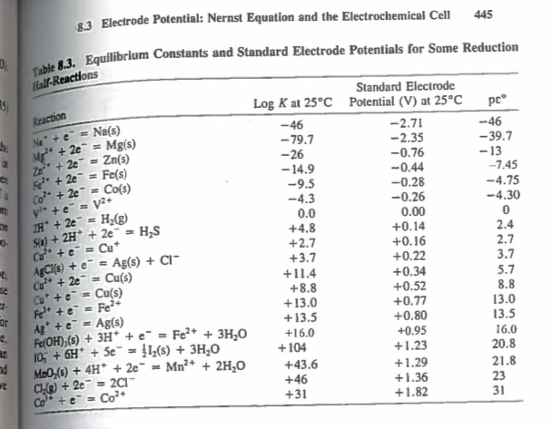

## Tables of constants

### Anderson - Std State Properties

<embed class="pdf-embed" src="assets/pdfs/Anderson_Appendix_B-Std_State_Properties.pdf" type="application/pdf">

[Download PDF](assets/pdfs/Anderson_Appendix_B-Std_State_Properties.pdf){.pdf-link}

### Thermodynamic Properties - Stumm and Morgan, Appendix 3

<embed class="pdf-embed" src="assets/pdfs/Stumm_Morgan_Appendix3_Thermodynamic_properties.pdf" type="application/pdf">

[Download PDF](assets/pdfs/Stumm_Morgan_Appendix3_Thermodynamic_properties.pdf){.pdf-link}

### Equilibrium Constants and Standard Electrode Potentials - Stumm and Morgan, Table 8.3

## Extra reading on thermodynamics and chemical equilibria

### Chapter on Chemical Equilibrium - Snoeyink & Jenkins - 1980

<embed class="pdf-embed" src="assets/pdfs/Chem_Equil-SJ_Chap_3.pdf" type="application/pdf">

[Download PDF](assets/pdfs/Chem_Equil-SJ_Chap_3.pdf){.pdf-link}

### Energy yields of metabolic processes - Fenchel, King, Blackburn, Appendix 1

<embed class="pdf-embed" src="assets/pdfs/Fenchel_King_Blackburn_Appendix_1-Thermo_energy_yields.pdf" type="application/pdf">

[Download PDF](assets/pdfs/Fenchel_King_Blackburn_Appendix_1-Thermo_energy_yields.pdf){.pdf-link}

### Thermodynamics Background - Emerson and Hedges, Chapter 3
**This material is not included in Emerson and Hamme, so they have made it available as a pdf**

<embed class="pdf-embed" src="assets/pdfs/EH_Ch_3_thermodynamics_background.pdf" type="application/pdf">

[Download PDF](assets/pdfs/EH_Ch_3_thermodynamics_background.pdf){.pdf-link}

## Useful equations

<embed class="pdf-embed" src="assets/pdfs/Redox_equations_to_know_v4.pdf" type="application/pdf">

[Download PDF](assets/pdfs/Redox_equations_to_know_v4.pdf){.pdf-link}
